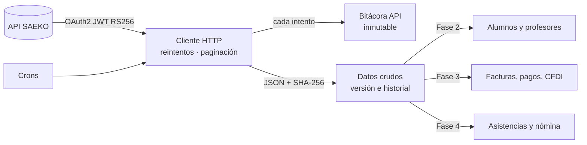

# SAEKO ⇄ Odoo

[](https://github.com/odoo/odoo/tree/19.0)
[](https://www.python.org/)
[](https://www.postgresql.org/)
[](https://www.gnu.org/licenses/lgpl-3.0)

Integración entre **SAEKO**, el sistema de control escolar de la universidad, y **Odoo 20**
(Community y Enterprise). Odoo consume la [API REST de SAEKO](https://apidoc.saeko.io), guarda cada
dato tal como llegó y deja rastro auditable de cada llamada, para después convertirlo en alumnos,
profesores, facturas, pagos y nómina dentro de Odoo.

## Módulos

| Módulo | Fase | Qué hace | Estado |
|---|---|---|---|
| [`saeko_connector`](saeko_connector) | 1 | Conexión OAuth2/JWT, bitácora de API, datos crudos versionados, crons, explorador de API | ✅ Estable |
| `saeko_academic` | 2 | Alumnos, profesores, planteles, ciclos, programas, grupos, materias y becas como registros de Odoo | Planeado |
| `saeko_account` | 3 | Conceptos, cargos, pagos, facturas y CFDI, adeudos y condonaciones | Requiere endpoints de SAEKO |
| `saeko_hr` | 4 | Carga horaria, checador, carga dada, suplencias, incidencias y bonos de profesores | Requiere endpoints de SAEKO |

## Ramas

| Rama | Odoo | Uso |
|---|---|---|
| `19.0` | 19.0 | Desarrollo activo |
| `20.0` | 20.0 | Solo correcciones |

Los cambios nuevos entran primero en `19.0`. Una corrección que también aplique a 19 se lleva a
`19.0` con `git cherry-pick`.

## Cómo funciona



1. **Todo aterriza primero en crudo.** El JSON de SAEKO se guarda sin transformar, con su huella
   SHA-256. Si cambia, la versión anterior pasa al historial; si deja de aparecer, se marca como ausente.
2. **El mapeo a Odoo es un paso aparte.** Si una regla cambia, se reprocesa el dato crudo sin volver a
   llamar a SAEKO.
3. **La bitácora no se pierde.** Se escribe en una transacción independiente, así que sobrevive aunque
   la sincronización falle. Llaves, JWT y tokens se guardan enmascarados.
4. **Los endpoints son datos, no código.** Rutas, dependencias y paginación se configuran desde Odoo;
   un endpoint nuevo de SAEKO no requiere programar.

## Estructura

```
.
├── README.md
└── saeko_connector/
    ├── services/          # Cliente SAEKO y firma JWT (Python puro, sin ORM)
    ├── models/            # Conexión, catálogo de recursos, bitácora, ejecuciones, datos crudos
    ├── wizard/            # Explorador de API, importación del Service Account
    ├── data/              # Catálogo de endpoints y crons
    ├── security/          # Grupos y ir.access.csv (formato de Odoo 20)
    ├── migrations/        # Scripts de actualización entre versiones
    ├── tests/             # Pruebas y SAEKO simulado
    ├── tools/             # Servidor SAEKO simulado para pruebas locales
    └── doc/               # Arquitectura, instalación, análisis de la API, roadmap
```

## Requisitos

* Odoo 19.0, Community o Enterprise.
* Python 3.12 a 3.14 y PostgreSQL 16 o superior.
* Salida HTTPS del servidor de Odoo hacia los servidores de SAEKO.
* Un *Service Account* de SAEKO (lo entrega su soporte) y un usuario de API creado en el Portal
  Administrador de SAEKO.

Las dependencias de Python (`cryptography`, `requests`) ya vienen con Odoo.

## Instalación

**Servidor propio**

```bash
git clone -b 19.0 <url-del-repositorio> /opt/odoo/saeko
```

Agregue `/opt/odoo/saeko` al `addons_path` de su `odoo.conf` y luego:

```bash
odoo-bin -c odoo.conf -d <base> -i saeko_connector --stop-after-init
```

**Odoo.sh**

Conecte este repositorio al proyecto (o agréguelo como submódulo) y use la rama `19.0`. Odoo.sh
detecta los módulos de las carpetas de primer nivel; instale *SAEKO Connector* desde *Aplicaciones*.

## Primeros pasos

1. *SAEKO → Configuración → Conexiones → Nuevo*.
2. **Importar Service Account**: pegue el bloque `service_account` de SAEKO e indique el correo del
   usuario de API.
3. **Probar conexión**: muestra cada paso, desde la llave hasta la lista de planteles.
4. En *Recursos y programación*, ejecute ▶ cada recurso y revise *Operación → Datos crudos*.
5. Active **Sincronización automática**.

Guía completa: [`saeko_connector/doc/INSTALACION.md`](saeko_connector/doc/INSTALACION.md).

### Probar sin credenciales

```bash
python3 saeko_connector/tools/mock_saeko_server.py --port 8765
```

Levanta un SAEKO simulado con autenticación real y datos de ejemplo, e imprime un `service_account`
listo para importar (usuario de API: `api@universidad.test`). Úselo con una conexión en modo
*Pruebas/Sandbox*, que acepta `http://`.

## Pruebas

```bash
odoo-bin -c odoo.conf -d <base_de_prueba> -i saeko_connector \
         --test-tags=/saeko_connector --stop-after-init
```

Las 15 pruebas cubren:

* Autenticación: firma JWT, conexión aceptada y rechazada, renovación del token ante 401, reintentos ante errores 5xx.
* Sincronización: paginación, detección de cambios, historial y ausentes, fallos aislados por recurso, detalle por ID, crons, importación de credenciales y explorador de API.
* Seguridad: permisos, multicompañía e inmutabilidad de la bitácora.

No usan red: corren contra el SAEKO simulado.

## Cobertura de los requerimientos

De los 25 datos que pidió la universidad, la API pública de SAEKO cubre **7** por completo y **4**
en parte; los otros **14**, todo el bloque de cobros, facturación, asistencias, suplencias y bonos,
no tienen endpoint documentado. El detalle dato por dato y las preguntas pendientes para SAEKO están
en [`saeko_connector/doc/ANALISIS_API.md`](saeko_connector/doc/ANALISIS_API.md).

## Documentación

| Documento | Contenido |
|---|---|
| [Arquitectura](saeko_connector/doc/ARQUITECTURA.md) | Autenticación, reintentos, motor de sincronización, seguridad |
| [Instalación y operación](saeko_connector/doc/INSTALACION.md) | Permisos, primera sincronización, operación diaria, endpoints nuevos |
| [Análisis de la API](saeko_connector/doc/ANALISIS_API.md) | Requerimiento por requerimiento contra la API de SAEKO |
| [Roadmap](saeko_connector/doc/ROADMAP.md) | Fases y mapeo a modelos de Odoo 20 |
| [Changelog](saeko_connector/CHANGELOG.md) | Cambios por versión |

## Contribuir

* Trabaje en una rama a partir de la versión destino, por ejemplo `19.0-saeko-academic`.
* Use las etiquetas de commit de Odoo: `[ADD]` módulo nuevo, `[IMP]` mejora, `[FIX]` corrección,
  `[MIG]` migración de versión, `[REF]` refactor.
* Todo cambio debe pasar las pruebas y traer las suyas.
* Un módulo nuevo define sus permisos en `security/ir.access.csv` (formato de Odoo 20), no en
  `ir.model.access.csv`.

## Seguridad

* **Nunca suba llaves, tokens ni bloques `service_account` al repositorio.** El `.gitignore` ya
  excluye las llaves del simulador (`tools/.mock_keys`).
* En Odoo, la llave privada solo es visible para el grupo *Ajustes* y jamás se escribe en la bitácora.
* Las conexiones en modo *Producción* exigen HTTPS.

## Licencia

[LGPL-3](https://www.gnu.org/licenses/lgpl-3.0) · © ARGIL CONSULTING · [anfepi.com](https://www.argil.mx)
